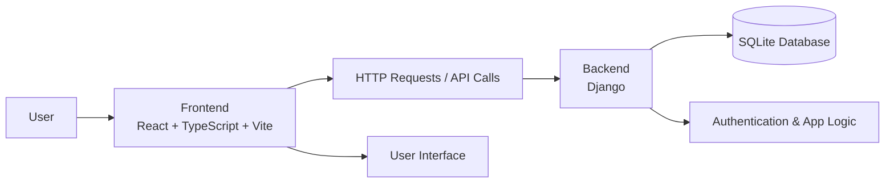
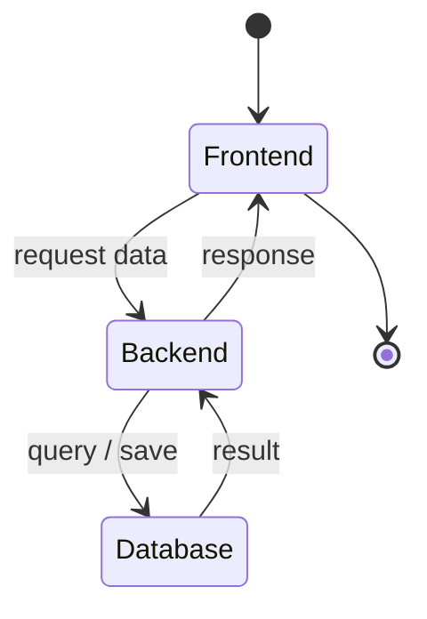

# Project Overview

This repository is a full-stack web application scaffold that combines:

- Frontend: React + TypeScript + Vite
- Backend: Django (Python)
- Database: SQLite for local development



## Tech Stack

### Frontend
- React 19
- TypeScript
- Vite
- CSS styling

### Backend
- Django 6.1
- Python
- SQLite database

## Project Structure

```text
PPL PRAK/
├── backend/
│   ├── backend/
│   │   ├── __init__.py
│   │   ├── settings.py
│   │   ├── urls.py
│   │   ├── asgi.py
│   │   └── wsgi.py
│   ├── manage.py
│   └── venv/
├── frontend/
│   ├── public/
│   ├── src/
│   ├── index.html
│   ├── package.json
│   ├── tsconfig.json
│   ├── vite.config.ts
│   └── README.md
├── .gitignore
├── README.mmd
└── .git/
```

## How It Works

1. The user accesses the React frontend in the browser.
2. The frontend communicates with the Django backend through API requests.
3. Django processes business logic and interacts with SQLite.
4. The backend returns data or responses back to the frontend.

## Run the Project

### Frontend
```bash
cd frontend
npm install
npm run dev
```

### Backend
```bash
cd backend
python manage.py migrate
python manage.py runserver
```

## Notes

This repo is currently a starter/full-stack base structure. It can be extended with:

- authentication
- REST API endpoints
- database models
- admin/dashboard features
- reusable React components


